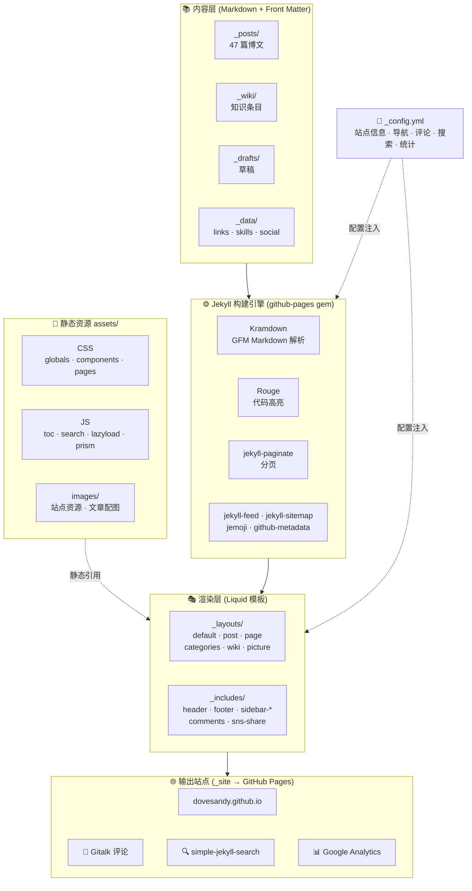

# 🌏 逃离地球的Sandy

> 🚀 Sandy想到月球看看奶奶 —— 一个基于 **Jekyll** 搭建的 GitHub Pages 个人技术博客

[](https://dovesandy.github.io)
[](https://jekyllrb.com)
[](LICENSE)
[](_posts)

---

## ✨ 特性

- 📚 **文章管理** —— 按分类组织的技术随笔，支持分页与归档
- 🔍 **站内搜索** —— 基于 [simple-jekyll-search](https://github.com/chriswhealey/search-simple-jekyll) 的标题/全文搜索
- 🏷️ **分类导航** —— 侧边栏分类统计，点击锚点快速跳转
- 💬 **评论区** —— 集成 [Gitalk](https://github.com/gitalk/gitalk)（GitHub Issue 作为评论存储）
- 📱 **响应式设计** —— 适配桌面与移动端
- 🖼️ **图片相册** —— 独立的图片页面与懒加载支持
- 📖 **Wiki 知识库** —— 独立 collection，用于沉淀体系化知识
- 🔗 **链接推荐** —— 友链 / 资源导航页
- 📊 **数据统计** —— Google Analytics 支持
- 🌐 **RSS 订阅** —— 通过 jekyll-feed 自动生成 `feed.xml`

## 🖥️ 界面预览


## 🏗️ 框架架构图



> 💡 **构建流程**：Markdown 内容经 Jekyll 解析后，注入 Liquid 布局模板与静态资源，构建为静态站点 `_site/`，推送到 GitHub 后由 Pages 服务自动发布。

## 🧰 技术栈

| 类别 | 技术 |
| :---: | :--- |
| 静态站点生成器 | 🛠️ Jekyll (GitHub Pages 官方支持) |
| Markdown 解析 | 📝 Kramdown (GFM 模式) |
| 代码高亮 | 🎨 Rouge |
| 主题模板 | 🎭 基于 [mzlogin](https://mzlogin.io) / [DONGChuan](https://dongchuan.github.io) 修改 |
| 前端基础 | 🌐 jQuery + Bootstrap + Octicons |
| 评论系统 | 💬 Gitalk |
| 搜索 | 🔍 simple-jekyll-search |
| 依赖管理 | 💎 Bundler (`github-pages` gem) |

## 📂 目录结构

```
.
├── _data/              # 数据文件（社交链接、技能、友链等）
│   ├── links.yml       # 🔗 友情链接数据
│   ├── skills.yml      # 🛠️ 技能数据
│   └── social.yml      # 📱 社交媒体配置
├── _drafts/            # 📝 文章草稿
├── _includes/          # 🧩 可复用组件（头部、底部、侧边栏等）
├── _layouts/           # 📐 页面布局（default / post / page / categories / wiki / picture）
├── _posts/             # 📚 博文（命名格式：YYYY-MM-DD-标题.md）
├── _wiki/              # 📖 Wiki 知识条目
├── assets/
│   ├── css/            # 🎨 样式（globals / components / pages / sections）
│   ├── js/             # ⚙️ 脚本（toc、搜索、懒加载、代码高亮等）
│   ├── images/         # 🖼️ 站点静态资源
│   └── search_data.json# 🔍 搜索索引数据
├── images/posts/       # 📷 文章配图（按分类目录组织）
├── pages/              # 📄 静态页面（关于、归档、分类、图片、链接、Wiki、404）
├── _config.yml         # ⚙️ 站点核心配置
├── Gemfile             # 💎 Ruby 依赖声明
└── index.html          # 🏠 博客首页（分页文章列表）
```

## 🚀 快速开始

### 环境准备

1. 🍎 macOS 自带 Ruby，其他系统请先安装 Ruby（≥ 2.5）
2. 安装 Bundler：

```bash
gem install bundler
```

### 本地运行

```bash
# 1️⃣ 安装依赖
bundle install

# 2️⃣ 启动本地服务（等价于 jekyll serve）
bundle exec jekyll serve
```

打开浏览器访问 👉 [http://localhost:4000](http://localhost:4000)

> 💡 **小贴士**：GitHub Pages 官方对 `github-pages` gem 的 Ruby 版本有要求，若 `bundle install` 报错，可尝试使用 `brew install ruby` 升级 Ruby，或用 Docker 镜像 `jekyll/jekyll:pages` 运行。

## ✍️ 如何写一篇新文章

1. 复制 [_posts/template.md](_posts/template.md)，按命名规范重命名为 `YYYY-MM-DD-文章标题.md`
2. 修改 Front Matter 头部信息：

```markdown
---
layout: post
title: 我的新文章 🎉
categories: JavaScript
description: 文章摘要
keywords: JavaScript, 关键词
---

正文内容，支持 GFM Markdown...
```

3. 文章配图放入 `images/posts/<分类>/` 目录，在文中以相对路径引用 📷
4. 草稿可先放在 `_drafts/` 中，用 `bundle exec jekyll serve --drafts` 预览

## 🗂️ 内容概览

当前站点已收录 **47 篇** 文章，主要分类分布：

| 分类 | 数量 | 内容方向 |
| :---: | :---: | :--- |
| JavaScript | 19 | 闭包、原型链、Promise、防抖节流、跨域、事件循环等 |
| Examination | 8 | 华为 OD 面试、前端模拟面试真题 |
| CSS | 5 | 盒模型、浮动、定位、z-index 等 |
| Vue | 4 | Vue 响应式原理、Vuex、生命周期 |
| Film | 4 | 影视剧评 🎬 |
| Git | 3 | Git 命令与 .gitignore 实践 |
| Webpack | 2 | 打包原理与面试题 |
| Java | 2 | 数据类型等基础 |

## ⚙️ 站点配置说明

核心配置位于 [_config.yml](_config.yml)：

- 📌 `title` / `description` / `keywords`：站点 SEO 信息
- 🧭 `navs`：顶部导航菜单（首页 / 分类 / 图片 / 维基 / 链接 / 关于）
- 💬 `comments_provider`：评论组件（支持 `disqus` / `gitment` / `gitalk`）
- 🔎 `simple_jekyll_search`：搜索行为（全文搜索开关、结果条数上限）
- 📰 `paginate`：首页每页文章数

## 🌐 部署

仓库推送到 `main`（或 `master`）分支后，GitHub Pages 会自动构建发布：

```bash
git add .
git commit -m "📝 post: 新增一篇文章"
git push
```

访问地址：https://dovesandy.github.io ✨

## 📬 提交代码模版（Commit Message）

提交信息采用 **Emoji + Type: 描述** 的规范格式，一行标题简明扼要，需要时在正文中补充细节：

```
<emoji> <type>(<scope>): <subject>

<body>

<footer>
```

### Type 类型说明

| Emoji | Type | 使用场景 |
| :---: | :---: | :--- |
| 📝 | `post` | 新增或更新博文 |
| ✨ | `feat` | 新功能（页面、组件、插件） |
| 🐛 | `fix` | 修复 Bug |
| 🎨 | `style` | 样式/UI 调整（不影响逻辑） |
| 🔧 | `chore` | 构建、配置、依赖等杂项 |
| 📚 | `docs` | 文档更新（README 等） |
| ♻️ | `refactor` | 重构（模板、脚本、目录结构） |
| ⏪ | `revert` | 回滚提交 |
| 🗑️ | `remove` | 删除文件/无用代码 |

`scope` 为可选的改动范围，如 `_posts`、`_layouts`、`assets/css`、`_config` 等。

### 示例

```bash
# 新增文章
📝 post: 新增《JavaScript 事件循环详解》

# 修复 Bug（带正文说明）
🐛 fix(_layouts): 修复文章页侧边栏目录在移动端无法展开

现象：窄屏下 toc 容器高度为 0。
原因：jquery.toc.js 在 DOM ready 前初始化。

# 样式调整
🎨 style(assets/css): 代码块背景色改为深色主题

# 配置/依赖
🔧 chore(Gemfile): 添加 webrick 以支持 Ruby 4.0 本地预览

# 文档
📚 docs(README): 更新本地运行环境说明
```

### 快速提交

```bash
git add .
git commit -m "📝 post: 新增一篇文章"
git push
```

> 💡 **小贴士**：可在仓库设置 `.git/.gitmessage` 模版（配合 `git config commit.template .git/.gitmessage`），`git commit` 时自动带出上述格式提示。

## 📝 License

本项目内容采用 [MIT](LICENSE) 协议开源，欢迎转载，请注明出处。

## 🙏 致谢

- 🎨 本博客外观基于 [mzlogin](https://mzlogin.io) 修改，感谢！
- 🎨 本博客外观基于 [DONGChuan](https://dongchuan.github.io) 修改，感谢！

---

> 💙 如果这个项目对你有所帮助，欢迎点个 **Star** ⭐！
